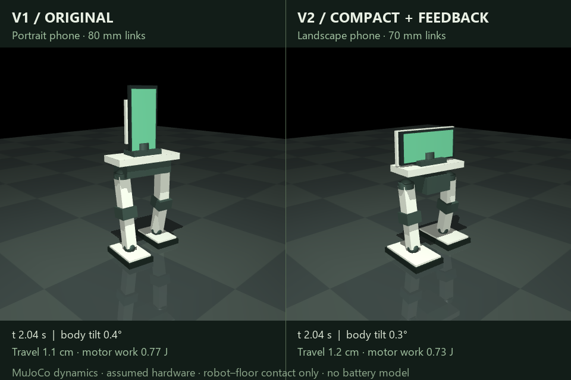

# Mobile Robot

A phone-carrying, two-legged robot concept with interactive anatomy, reproducible MuJoCo physics experiments, and an improved compact design.

## Engineering simulation workbench (v0.2)

The live lab now has a server-owned fixed-step physics loop, explicit operating states, an operator heartbeat watchdog, a latched simulation stop, run provenance exports, deterministic replay checks, and automated control/API tests.

```sh
python -m pip install -r requirements.txt
python lab_server.py --port 8766
```

Open **http://127.0.0.1:8766** in a browser. Choose a preset, then Start. Pause before changing configuration. **Stop & latch** freezes this simulation; it is not a hardware emergency stop. To recover from a latched stop or fault, choose **Acknowledge**, then **Apply changes & reset physics**. Closing/disconnecting the operator tab for more than two seconds latches a fault while running. There is one simulation and one operator per server process.

Download a complete run and check replay:

```sh
python replay_run.py robot-run.json
python -m unittest discover -s tests -v
```

The run file contains source/model hashes, configuration, engine versions, disturbance inputs, event history, final state and telemetry. Windows and Linux test jobs are configured in GitHub Actions. Their remote results must be inspected before treating a release as checked on both platforms.

See [software quality and limitations](SOFTWARE-QUALITY.md). This is an engineering development workbench, not certified industrial control software or validated real-robot control.



## Explore the design

Download or clone this repository, then open these self-contained HTML files in a browser:

- **[V2 design comparison](phone-biped-v2.html)** — original versus compact geometry, side-by-side movement and push-test videos, and motor-effort comparisons.
- **[Physics lab](phone-biped-physics.html)** — original standing, stepping and push experiments with playback telemetry.
- **[Interactive anatomy](phone-biped-anatomy.html)** — selectable assemblies, phone-neck turning, and a simplified static balance explorer.

GitHub displays HTML source. Open the downloaded files locally to use the interactive pages. Videos and replay data are embedded, so those pages work offline.

Standalone videos: [V2 movement comparison](revised-step-comparison.mp4), [V2 lateral-push comparison](revised-push_side-comparison.mp4), [original standing](stand.mp4), [original stepping](step.mp4), [original push](push.mp4).

## Proposed robot

- A phone provides the display, camera, voice interface and high-level app commands.
- A local controller handles balance and joint commands independently of phone/cloud latency.
- Each leg has hip yaw, hip roll, hip pitch, knee pitch, ankle pitch and ankle roll; a pan/tilt neck brings the total to 14 actuated axes.
- The compact revision uses a landscape phone mount, shorter legs, a lower battery and broader soles.

| Parameter | Original | Compact V2 |
| --- | --- | --- |
| Thigh / shin length | 80 / 80 mm | 70 / 70 mm |
| Sole dimensions | 96 × 60 mm | 120 × 72 mm |
| Foot-centre spacing | 106 mm | 118 mm |
| Assumed total mass | 1.691 kg | 1.659 kg |
| Initial centre of mass | 169 mm | 146 mm |
| Overall height | 367 mm | 277 mm |

## Preliminary simulation findings

For the same first 10 cm of simulated movement, V2 uses approximately **15% less positive actuator work**, with a **20% lower squared-torque integral**. A finer timestep preserves a work benefit of about 13.5%. V2 survives the lateral push that topples the original; **both fall under the forward push**.

These are actuator-effort comparisons, **not measured battery savings**. Peak movement torque rises slightly in V2, so the results do not justify smaller motors. Both designs still shuffle with substantial foot slip; they do not have a validated walking gait.

Read [V2 design notes](REVISED-DESIGN.md), [original physics notes](PHYSICS-README.md), [test results](revised-design-results.json), and [numerical checks](revised-design-checks.json) for methods and limitations.

## Run the experiments

Python 3.11 was used for the recorded runs. Create a virtual environment if desired, then install the dependencies:

```sh
python -m pip install -r requirements.txt
python simulate_robot.py
python simulate_robot.py --render
python improve_design.py
```

`simulate_robot.py` writes the original model, telemetry and summaries beside the script; `--render` also produces the original videos. `improve_design.py` runs a geometry/controller sweep. The scripts write output files, so use a separate checkout or commit your changes before rerunning experiments you want to preserve.

To generate the selected V1/V2 state recordings:

```python
from improve_design import experiment

for scenario in ["stand", "step", "push", "push_side"]:
    experiment(design="baseline", scenario=scenario, record=True)
    experiment(design="compact", feedback=.5, scenario=scenario, record=True)
```

Then render the comparison videos and rebuild the replay pages:

```sh
python render_revised_design.py
python tools/build_physics.py
python tools/build_revision.py
```

The replay builders embed the current video exports and recorded result files. They do not rerun physics. The V2 narrative contains the delivered run's numbers; update it if model parameters change. The video renderer currently uses Windows Segoe UI fonts; adjust those font paths for other operating systems.

## What is and is not modelled

MuJoCo simulates gravity, a free-floating body, joint dynamics, torque-limited position servos and robot–floor contact with friction. No root trajectory or supporting tether is imposed. V2 adds ideal body-angle/rate feedback.

Dimensions, masses, inertias, grip and motor limits are assumptions. Robot self-collision is disabled. Motor electrical and thermal behaviour, gear backlash, real sensor noise/delays, phone tracking, body-turning steps, obstacles and stairs are not validated. The neck-turning test commands a pan angle; it does not run a person detector.

Next work: CAD and mass measurements, collision geometry, a proper lift-and-place gait, recovery steps, realistic actuators, and whole-device input-power measurements.

## Attribution

The anatomy illustration uses the MIT-licensed [Anatomy skill and SVG kit](https://github.com/wheresryan22/anatomy). Its notice is included in [ANATOMY-LICENSE.txt](ANATOMY-LICENSE.txt). The upstream repository is not vendored here.

Physics engine: [MuJoCo](https://mujoco.readthedocs.io/en/stable/). Background: [MIT walking energetics](https://underactuated.mit.edu/simple_legs.html) and [Maxon motor data and losses](https://support.maxongroup.com/hc/en-us/articles/360013761160-Motor-data-and-simulation).
